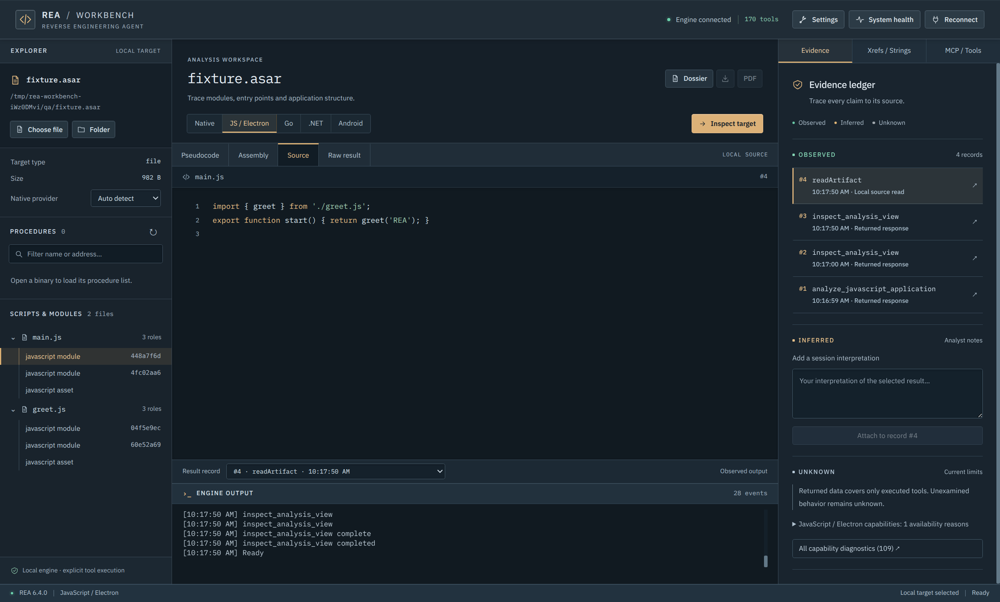

# REA Workbench

A standalone local engineering workstation delivered as a downloadable Electron desktop app. The installer bundles Electron's Node runtime and REA 6.4.0. No separate Node or npm installation is needed to run a packaged app.




The three-pane workspace provides local file/folder drag-and-drop, native provider selection, searchable procedures, pseudocode and assembly views, JavaScript/Electron structure, Go/native, .NET and Android profiles, strings/cross references, an output console, evidence records, Markdown/PDF dossiers, and a schema-driven browser of every tool advertised by the engine. Controls reflect the connected engine's actual availability. Version 0.2.0 includes a persistent **Results** library, with saved recovered files, plain-English static explanations, code previews, provenance and portable exports. See [Results](docs/results.md).

## Run from source

Use Node 22.19+ or another runtime supported by the pinned REA release.

```sh
npm ci
npm run dev
```

For the built desktop app:

```sh
npm run build
npm start
```

Both `npm run start` and `npm run dev` also work from the `standalone/` directory.

### Linux startup

Source launchers select X11/XWayland before starting Electron when `DISPLAY` is available. An explicit `--ozone-platform=wayland`, `x11`, or `headless` argument is preserved. Packaged apps retain the backend selected at executable startup; the main script does not change it afterward. Electron selects Ozone before the main script runs, so changing that switch in JavaScript can create inconsistent native/renderer display backends. See [Electron's startup switch documentation](https://github.com/electron/electron/blob/main/docs/api/command-line-switches.md#--ozone-platformplatform-linux).

If using an older 0.1.1 Linux download on an affected Wayland desktop, launch it with `--ozone-platform=x11`. For the old source checkout, use `npm run start -- --ozone-platform=x11` from its root. Version 0.1.2 fixes normal source startup and adds the missing standalone dev command.

If Linux reports that `chrome-sandbox` must be owned by root with mode 4755, resolve the sandbox configuration for that trusted Electron installation using your distribution's guidance. Reinstalling dependencies can replace that helper. Graphics flags do not repair sandbox permissions; this app continues to use sandboxed renderers.

Choose a target, connect the engine, and inspect it. Selecting a different target starts a fresh owned MCP session to keep evidence separate. An ordinary browser shows the layout but cannot access local files or the engine; these operations require the Electron preload bridge.

## Build installers

```sh
npm run package:linux
npm run package:win
npm run package:mac
```

Output: `release/`. Use the native release workflow to produce new candidates from the cleaned source. Linux emits AppImage and tar.gz; Windows emits a setup installer and portable EXE; macOS emits DMG and ZIP. Build/test macOS packages on macOS. The supplied release workflow builds Linux x64, Windows x64, and macOS x64/arm64 on native runners. See [release workflow](docs/desktop-release.md).

Packaged JavaScript/Electron static analysis and archive inventory use the bundled engine. Native decompilation requires an installed/configured Ghidra, Hopper, or IDA provider. The [free-provider guide](docs/free-providers.md) covers the 12 saved settings, verified readiness, and remaining host/provider limits. Android code inspection requires its own REA-documented prerequisites. System health shows the actual host configuration; a catalogued tool does not mean its provider is available. Proprietary toolkits and their licenses are not bundled.

## Evidence and process behavior

The engine uses a persistent stdio MCP session and the actual server catalog/schema. REA is spawned without a shell. Progress and bounded diagnostics are returned through the preload event subscription. Cancel, target change and application exit close owned sessions. Input/output paths are checked by the host; renderer code receives no filesystem or Node API.

Complete call records and canonical evidence snapshots remain in the app's user-data analysis directory. Exporting Markdown or PDF also writes a sibling evidence directory containing the canonical evidence and complete operation records. Share the report together with that directory to preserve the supporting artifacts.

The app keeps its own profile and isolated engine configuration home. Provider paths must be chosen in Settings; ambient provider registrations and agent credentials are not imported. Packaged renderer network requests are blocked. See [local data and public source](docs/privacy.md) for the boundaries and the clean source export workflow.

## Verification

`npm run typecheck`, `npm test`, and `npm run build` validate the shared application. Runtime evidence and host-specific limits are recorded in `docs/verification.md`. Windows/macOS installer configuration is distinct from a successful package build or a verified installed app.

REA Workbench has no open-source project license; its package metadata is `UNLICENSED`. Third-party dependencies, including the independent [REA engine](https://github.com/morluto/rea), retain their own licenses and notices. See [third-party notices](THIRD_PARTY_NOTICES.md).
